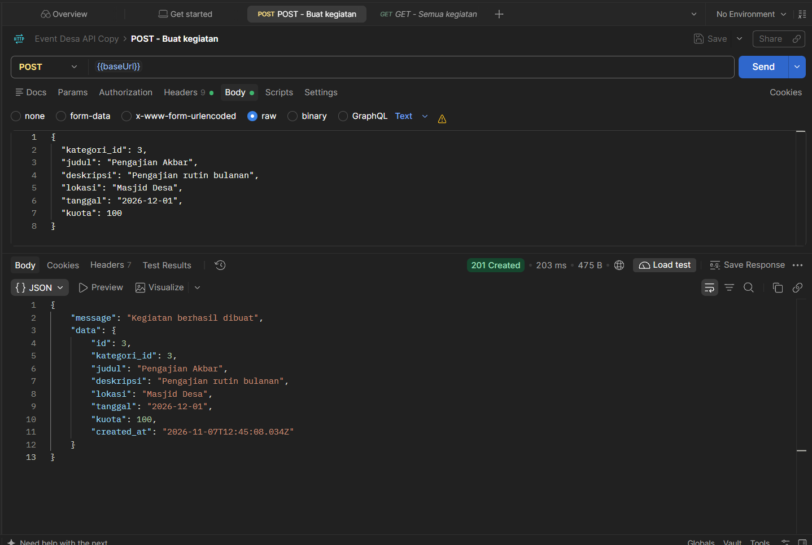
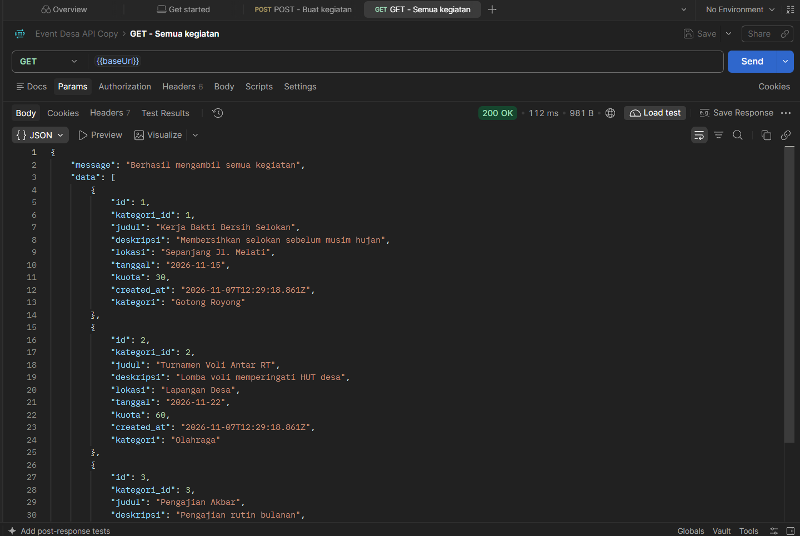
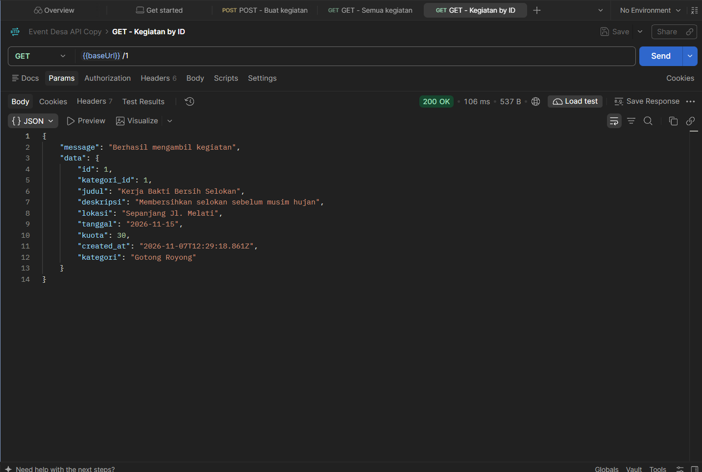
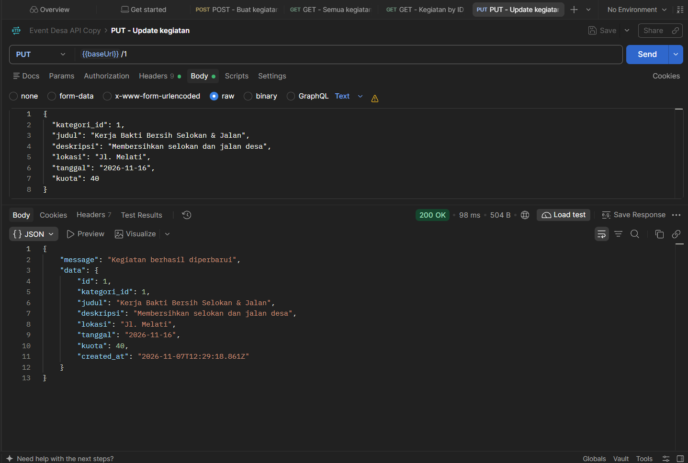
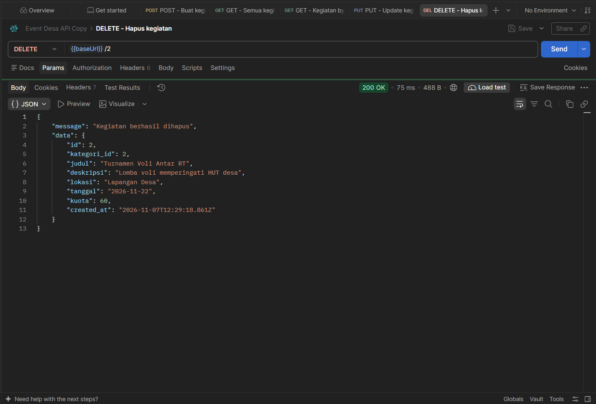

# Sistem Informasi Event Desa — Backend (Express.js + PostgreSQL)

## Studi Kasus

Desa Sukamaju sering menyelenggarakan kegiatan warga seperti kerja bakti, turnamen olahraga, dan pengajian. Selama ini pengumuman dan pendaftaran kegiatan masih dicatat manual, sehingga perangkat desa sulit mengetahui siapa saja yang ikut, siapa panitianya, dan berapa kuota yang tersisa.

Dibutuhkan **sistem informasi event desa** dengan fitur:

1. **Data RT dan warga**: setiap warga tercatat di satu RT.
2. **Profil warga**: detail tambahan setiap warga (alamat, tanggal lahir, jenis kelamin, pekerjaan).
3. **Kategori kegiatan**: pengelompokan kegiatan (Gotong Royong, Olahraga, Keagamaan, dll.).
4. **Kegiatan desa**: judul, deskripsi, lokasi, tanggal, dan kuota peserta.
5. **Pendaftaran peserta**: warga dapat mendaftar ke banyak kegiatan, dan satu kegiatan diikuti banyak warga, beserta status kehadirannya.
6. **Panitia kegiatan**: warga dapat menjadi panitia di beberapa kegiatan dengan peran tertentu.

## Struktur Database (7 tabel)

| Relasi | Tabel |
|---|---|
| One-to-one | `warga` ↔ `profil_warga` (`profil_warga.warga_id` UNIQUE) |
| One-to-many | `rt` → `warga`, `kategori_kegiatan` → `kegiatan` |
| Many-to-many | `warga` ↔ `kegiatan` lewat `pendaftaran_kegiatan` dan `panitia_kegiatan` |

Kode SQL ada di [`database.sql`](database.sql).

## Menjalankan Project

```bash
npm install
cp .env.example .env        # isi password PostgreSQL
psql -U postgres -c "CREATE DATABASE event_desa"
psql -U postgres -d event_desa -f database.sql
npm start                   # http://localhost:3000
```

## Endpoint REST API (tabel `kegiatan`)

| Metode | URL | Keterangan |
|---|---|---|
| GET | `/api/kegiatan` | Dapatkan semua data |
| GET | `/api/kegiatan/:id` | Dapatkan data berdasarkan ID |
| POST | `/api/kegiatan` | Membuat data baru |
| PUT | `/api/kegiatan/:id` | Memperbarui data |
| DELETE | `/api/kegiatan/:id` | Menghapus data |

Contoh body POST/PUT (`kategori_id`, `judul`, `tanggal` wajib):

```json
{
  "kategori_id": 3,
  "judul": "Pengajian Akbar",
  "deskripsi": "Pengajian rutin bulanan",
  "lokasi": "Masjid Desa",
  "tanggal": "2026-12-01",
  "kuota": 100
}
```

Collection Postman siap import: [`event-desa.postman_collection.json`](event-desa.postman_collection.json).

## Hasil Tes di Postman

### POST (membuat data baru)


### GET (dapatkan semua data)


### GET (dapatkan data berdasarkan ID)


### PUT (update data berdasarkan ID)


### DELETE (hapus data berdasarkan ID)

